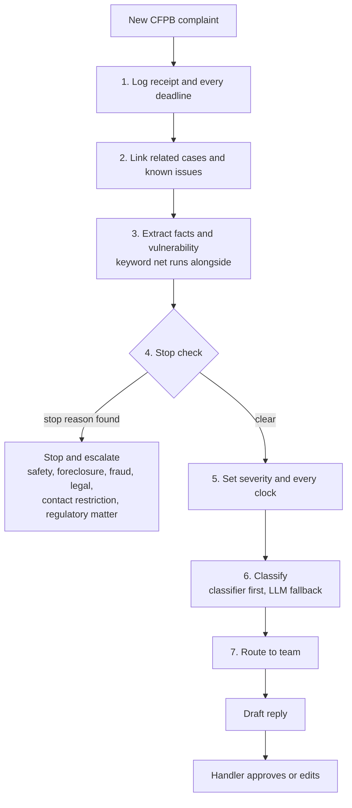

# FirstLook: Complaint Triage Agent

**Every complaint gets the right first look, routed right and answered on time.**

FirstLook triages US bank customer complaints. It classifies each complaint by product and issue, flags vulnerable
customers, sets every regulatory deadline, routes the case to the right team and drafts a reply for a handler to
approve. It is built on the public CFPB complaints archive.

> **Status: design complete, build in progress.** The design decisions are finished and documented. The agent and
> the evaluation run are being built now. No results are reported until the evals run. Nothing here is a
> production number.
>
> **Source code is private.** This repository describes the design. I'm happy to walk through the code on request.

## The problem

US banks must log, investigate and answer every complaint on time. Handlers read long narratives, tag product and
issue by hand, spot vulnerable customers and look up similar cases. A misclassified complaint goes to the wrong
team and misses its deadline.

## How it works

Every complaint goes through the same seven steps in a fixed order. Rules then pick one of five predefined paths:
standard, multi-product, repeat or related, stop-and-escalate, or degraded. There is no free agent loop, so every
path can be tested.

## Key design choices

| Area | Decision |
|---|---|
| Trigger | A new complaint lands in the case store and is processed as it arrives |
| Brain | Fine-tuned classifier, one pinned LLM, rules, a keyword net and hybrid search |
| Retrieval | RAG over vectorized past complaints, used to find similar cases |
| Memory | No live memory. It learns only through a reviewed update path |
| Control loop | Fixed spine, predefined paths and six stop reasons |
| Human in the loop | A person approves every reply. Nothing leaves the bank without approval |
| Framework | LangGraph, kept thin |

Each choice has a one-page record with the options rejected. See [docs/design-decisions.md](docs/design-decisions.md).

## What FirstLook never does

- Sends anything outside the bank
- Closes a case or changes its status
- Writes to account systems
- Removes or shortens a regulatory deadline
- Treats a failed stop check as anything other than a stop

## Evaluation plan

300 CFPB complaints and a separate set of 60 high-risk complaints, all labelled before FirstLook runs. 60 cases
are labelled twice to measure agreement. Details are in [docs/evaluation.md](docs/evaluation.md).

## Stack

Python · LangGraph · LangChain · RAG (chunking, vectorization, hybrid search) · Claude API

## Scope and limits

- Phase 1 covers checking, credit card and mortgage complaints from the CFPB portal.
- Tested on public CFPB data, not live bank traffic.
- The public data has no customer identity, so customer-context fields are empty in the demo.

## Screenshots

Screenshots and a demo video will be added to [assets/screenshots](assets/screenshots) when the demo is ready.
